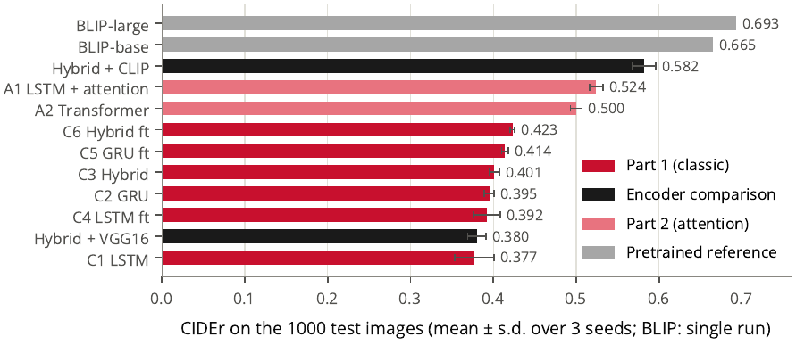
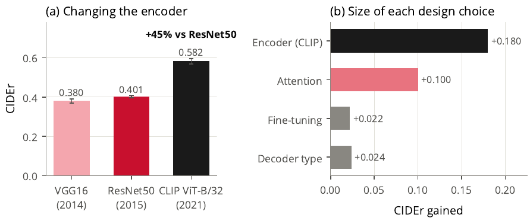
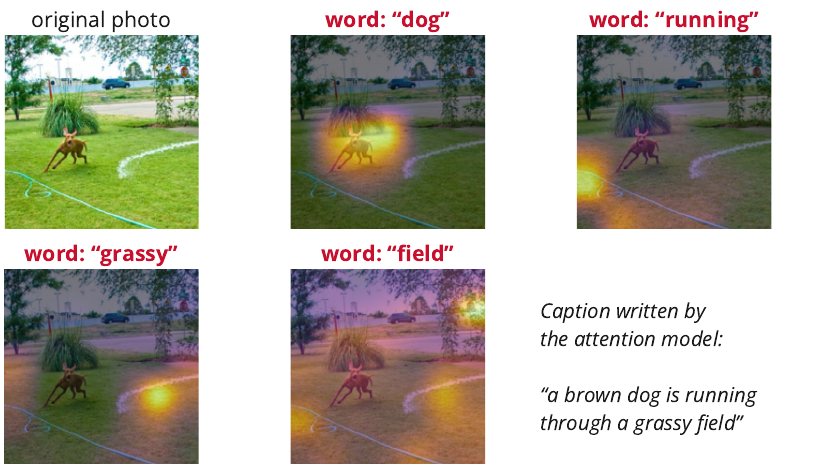
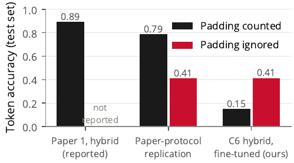
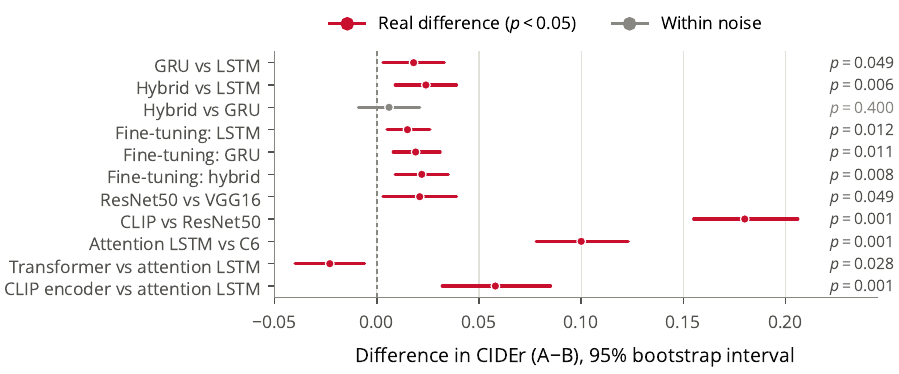
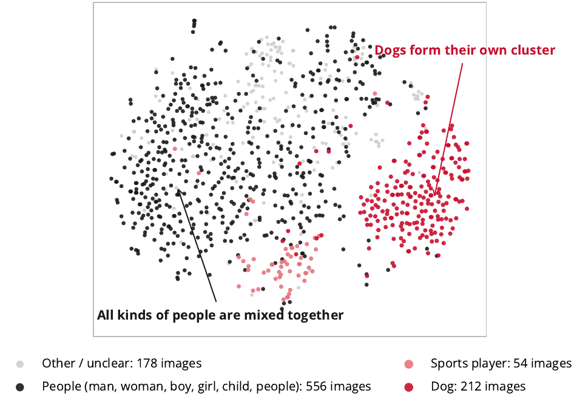

# Encoder–Decoder Architectures for Image Captioning

<p align="center">
  <b>A controlled ablation of ResNet50 with LSTM, GRU, hybrid and attention-based decoders on Flickr8k</b><br>
  Deep Learning course project · B.Tech CSBS · SVKM's NMIMS, MPSTME, Mumbai · AY 2026–27
</p>

<p align="center">
  
  
  
  
</p>

<p align="center">
  <b>Padmanabh Kakad (E025) · Abizer Masavi (E034) · Arzaan Mulla (E039)</b>
</p>

<p align="center">
  📄 <a href="docs/report/report.pdf"><b>Read the full report (PDF, 19 pages)</b></a>
</p>

---

## What is this?

Show the model a photo, and it writes a sentence describing it:

```
🖼️  photo  →  🧠 CNN encoder (ResNet50 / VGG16 / CLIP)  →  🔤 decoder (LSTM / GRU / hybrid / attention / Transformer)  →  💬 "a brown dog is running through a grassy field"
```

Most captioning projects build one model and report one number. This project runs a **controlled study**:
every model shares the same data split, vocabulary, training recipe and evaluation code; **exactly one design
choice changes at a time**; every configuration is trained with **three random seeds**; and every difference
is checked with a **paired bootstrap significance test**.

## Key findings

| # | Finding |
|---|---|
| 1 | **The encoder matters most.** Swapping ResNet50 for CLIP raises CIDEr from 0.401 to 0.582 (**+45%**). |
| 2 | **Attention is second.** Letting the decoder look at 49 image regions raises CIDEr from 0.423 to 0.524 (**+24%**) with the same number of weights. |
| 3 | **Fine-tuning and the choice of LSTM vs GRU give small but real gains** (about 5%). |
| 4 | **The hybrid LSTM→GRU decoder is no better than a plain GRU** (p = 0.40). |
| 5 | **The reference paper's 0.89 accuracy is mostly padding.** The same kind of model scores 0.79 with padding counted and only 0.41 on real words, at identical caption quality. |
| 6 | **BLEU ranks our models correctly** (Spearman ρ = 0.92 with the reference-free CLIPScore), but not models that write in a different style. |

---

## Results

All numbers are on the 1,000 test images. Trained models: mean over 3 seeds, beam width 5.

| Model | BLEU-1 | BLEU-4 | METEOR | CIDEr | CLIPScore | Hallucination ↓ |
|---|:---:|:---:|:---:|:---:|:---:|:---:|
| C1 ResNet50 + LSTM | 0.581 | 0.168 | 0.175 | 0.377 | 0.492 | 42.5% |
| C2 ResNet50 + GRU | 0.580 | 0.172 | 0.179 | 0.395 | 0.502 | 36.6% |
| C3 ResNet50 + Hybrid LSTM→GRU | 0.586 | 0.174 | 0.179 | 0.401 | 0.503 | 40.3% |
| C6 Hybrid, fine-tuned ResNet50 | 0.590 | 0.184 | 0.183 | 0.423 | 0.510 | 38.1% |
| E1 VGG16 + Hybrid | 0.584 | 0.167 | 0.174 | 0.380 | 0.496 | – |
| **E2 CLIP + Hybrid** | **0.655** | **0.233** | **0.217** | **0.582** | **0.594** | – |
| A1 ResNet50 + LSTM with attention | 0.629 | 0.221 | 0.203 | 0.524 | 0.549 | 26.2% |
| A2 ResNet50 + Transformer | 0.617 | 0.210 | 0.199 | 0.500 | 0.551 | 25.2% |
| *BLIP-large (pretrained reference)* | *0.626* | *0.206* | *0.259* | *0.693* | *0.641* | *26.0%* |
| *Human captions* | – | – | – | – | *0.712* | – |

<p align="center"></p>

### What matters: encoder vs decoder

<p align="center"></p>

### Where the attention model looks

<p align="center"></p>

### The accuracy illusion

The reference paper reports **0.8932 accuracy**. Captions are padded to 34 tokens, and predicting
`<pad>` after `<end>` is trivial. Counting those positions inflates accuracy without improving the captions.

<p align="center"></p>

### Which differences are real?

<p align="center"></p>

### What the encoder sees

<p align="center"></p>

More figures (ablation, decoding, hallucination, beam-search tree, failure gallery) are in the [report](docs/report/report.pdf).

---

## Experiments

**Part 1: classic decoders** (3 seeds each)

| ID | Config | Decoder | ResNet50 encoder |
|---|---|:---:|:---:|
| C1 | `lstm_frozen` | LSTM | frozen |
| C2 | `gru_frozen` | GRU | frozen |
| C3 | `hybrid_frozen` | LSTM → GRU | frozen |
| C4 | `lstm_finetuned` | LSTM | last block (conv5) fine-tuned |
| C5 | `gru_finetuned` | GRU | last block (conv5) fine-tuned |
| C6 | `hybrid_finetuned` | LSTM → GRU | last block (conv5) fine-tuned |
| PP | `paper_protocol` | LSTM → GRU | frozen, trained exactly like the reference paper |

**Encoder comparison** (hybrid decoder, frozen encoder): `hybrid_vgg16` (VGG16), `hybrid_frozen` (ResNet50), `hybrid_clip` (CLIP ViT-B/32).

**Part 2: attention** (3 seeds each)

| ID | Config | Decoder | Image input |
|---|---|---|---|
| A1 | `attention` | LSTM + soft attention | 7×7 grid of ResNet50 regions |
| A2 | `transformer` | 3-block Transformer decoder | 7×7 grid of ResNet50 regions |
| B1/B2 | `blip_base`, `blip_large` | pretrained BLIP, no training (reference only) | image |

**Evaluation:** BLEU-1–4, METEOR, ROUGE-L, CIDEr (official COCO code), CLIPScore / RefCLIPScore (CLIP ViT-L/14),
object hallucination (CHAIR), key-object recall, caption diversity, masked and unmasked token accuracy,
and paired bootstrap tests (10,000 resamples, Holm correction).

---

## Interactive dashboard

A Streamlit app that runs locally on a laptop CPU:

- **Live captioning:** upload a photo or use the webcam, and get captions from four models at once.
- **Word by word:** step through the caption and see each word's attention or Grad-CAM heatmap and the top-5 candidate words.
- **Beam-search tree** for your own photo.
- Every result as an interactive chart: significance tests, the accuracy illusion, a gallery of all 1,000 test images, hallucination analysis, a clickable t-SNE map and training curves.

Setup instructions: [`dashboard/README.md`](dashboard/README.md).

```bash
streamlit run dashboard/app.py
```

---

## Project structure

```
DL-Project/
├── notebooks/00_colab_pipeline.ipynb   ▶ runs the whole study on Colab (start here)
├── train.py                            train one config + seed (resumable)
├── evaluate.py                         all metrics + predictions for one run
├── inference.py                        caption any image from the command line
├── build_tokenizer.py                  vocabulary from the training captions
├── experiments/config_*.yaml           one file per configuration
├── src/
│   ├── data_loader.py                  captions → image-level train/val/test split
│   ├── tokenizer.py                    cleaning + vocabulary
│   ├── feature_extraction.py           ResNet50 (pooled, conv4, 7×7 grid), VGG16, CLIP features
│   ├── dataset.py                      batches of (image features, caption)
│   ├── evaluation.py                   BLEU, METEOR, ROUGE-L, CIDEr, key-object recall, diversity
│   ├── scoring.py                      shared caption scoring (no TensorFlow import, so BLIP/PyTorch runs safely)
│   ├── analysis.py                     Grad-CAM, attention maps, t-SNE, beam trees, error taxonomy
│   ├── models/                         encoders, LSTM/GRU/hybrid/attention/Transformer decoders, metrics
│   └── utils/                          batched greedy + beam search, run I/O
├── scripts/
│   ├── run_experiments.py              train + evaluate many configs and seeds
│   ├── aggregate_results.py            results tables
│   ├── eval_pretrained.py              BLIP reference models
│   ├── clipscore.py                    reference-free evaluation
│   ├── significance.py                 paired bootstrap tests
│   ├── run_analysis.py                 heatmaps, t-SNE, beam trees, error analysis
│   └── export_dashboard.py             builds the dashboard bundle
├── dashboard/                          Streamlit app (app.py, engine.py)
├── tests/                              pytest suite (CPU only, no dataset needed)
└── docs/
    ├── report/                         final report: report.pdf + LaTeX source
    ├── images/                         figures used in this README
    ├── proposal.pdf
    └── literature_review.md
```

---

## How to run

**On Colab (recommended):** open `notebooks/00_colab_pipeline.ipynb`, select an **L4 GPU**, and run the cells in order.
Every run is saved to Google Drive and resumes automatically after a disconnect.

**Locally:**

```bash
pip install -r requirements.txt
python src/data_loader.py                     # needs data/raw/captions.txt + data/raw/Images/
python build_tokenizer.py
python src/feature_extraction.py --mode pooled
python src/feature_extraction.py --mode conv4
python scripts/run_experiments.py --stage frozen --seeds 1,2,3
python scripts/run_experiments.py --stage finetuned --seeds 1,2,3
python scripts/run_experiments.py --stage paper --seeds 1
python scripts/aggregate_results.py
python inference.py --image photo.jpg --config_name hybrid_frozen --seed 1
pytest tests/
```

**Rebuild the report:** the LaTeX source is in `docs/report/`. Compile `main.tex` with **XeLaTeX**
(on Overleaf: Menu → Compiler → XeLaTeX), then BibTeX, then XeLaTeX twice.

---

## Built on

| Paper | What it did |
|---|---|
| **Kavitha & Karpagam (2025)**, *Automatika* 66(3) ([DOI](https://doi.org/10.1080/00051144.2025.2485695)) | ResNet50 encoder + hybrid LSTM–GRU decoder with beam search on Flickr8k |
| **Ahmad, Azhar & Sattar (2023)** ([arXiv:2301.02440](https://arxiv.org/abs/2301.02440)) | CNN + GRU decoder with a semantic reconstruction module |

Dataset: **Flickr8k** (Hodosh, Young & Hockenmaier, 2013): 8,091 photos with 5 captions each, split by image
into 6,091 / 1,000 / 1,000 for training, validation and testing.

---

## Acknowledgements

Released under the [MIT License](LICENSE).
